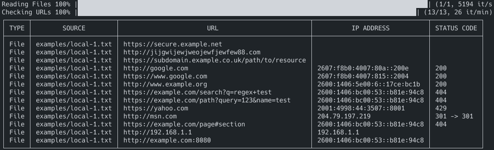

**url-finder**

- [About](#about)
- [Usage](#usage)
  - [Installation](#installation)
    - [Linux](#linux)
    - [Windows](#windows)
  - [Run](#run)

---

# About

`url-finder` can be used to probe HTTP(s) URLs on web pages or local files, searching for dead links or redirects.

It will report the URL it found, and IP Address and HTTP response codes if relevant.

**This was mostly "vibe-coded".**

Example:



---

Type | Source    | URL                 | IP Address | Status Code
-----|-----------|---------------------|------------|------------
File | File Name | https://example.com | 1.1.1.1    | 404

# Usage

```
Usage: url-finder [--log-format LOG-FORMAT] [--log-level LOG-LEVEL] [--log-colors] [--columns COLUMNS] [--file-extensions FILE-EXTENSIONS] [--no-query] [--query-threads QUERY-THREADS] [--show-all] [--user-agent USER-AGENT] TARGET

Positional arguments:
  TARGET                 Path to url-finder config file or URL

Options:
  --log-format LOG-FORMAT
                         Set log format: plain or JSON [default: plain]
  --log-level LOG-LEVEL, -l LOG-LEVEL
                         Set log level: INFO, DEBUG, ERROR, WARNING [default: INFO]
  --log-colors           Enables color in the log output [default: true]
  --columns COLUMNS      Columns to display in the output [default: type,URL,IPAddress,StatusCode,ResponseTime]
  --file-extensions FILE-EXTENSIONS
                         Comma-separated list of file extensions to parse [default: .md,.markdown,.txt,.text,.log,.cfg,.conf,.ini,.json,.yaml,.yml,.xml,.html,.htm]
  --no-query             Disable querying URLs
  --query-threads QUERY-THREADS
                         Number of concurrent threads to use for querying URLs [default: 3]
  --show-all             Show all results, or only failed URLs [default: false]
  --user-agent USER-AGENT
                         Set the User-Agent header for the HTTP request [default: url-finder/1.0]
  --help, -h             display this help and exit
  --version              display version and exit
```

## Installation

### Linux

```bash
curl -L "https://github.com/DaemonDude23/url-finder/releases/download/v0.1.0/url-finder_0.1.0_linux_amd64.tar.gz" -o url-finder.tar.gz && \
tar -xzf url-finder.tar.gz url-finder && \
sudo mv url-finder /usr/local/bin/ && \
rm url-finder.tar.gz && \
sudo chmod +x /usr/local/bin/url-finder
```

### Windows

1. Download the Windows version.
2. Untar it and put it in your `$PATH`.

## Run

```bash
url-finder ./examples/resources/url-finder.yaml
```

```bash
url-finder https://blog.andrewaadland.me/
```

## Development and maintenance

Use Go 1.27.3 or newer. From the repository root:

```bash
go -C src test -race -cover ./...
go -C src vet ./...
python3 -m unittest discover -s scripts -p 'test_*.py'
shellcheck scripts/*.sh
```

PRs run formatting, module verification, vet, race tests, cross builds,
`govulncheck`, workflow linting, release-script tests, and container smoke tests
when relevant files change. Documentation-only PRs still report a successful
`Go checks` job. `Dependency review` rejects new high-severity advisories.
The weekly Security workflow runs `govulncheck`, gosec, and Trivy; it can also
be started manually.

Renovate batches routine updates on Mondays, limits concurrent PRs to three,
and raises vulnerability fixes immediately. Go modules, major updates, and Nix
changes require review. Routine patch/minor container and action updates are
eligible for GitHub auto-merge after checks. To enforce these gates, configure
branch protection to require `Go checks` and `Dependency review` and enable
repository auto-merge. The unused Dependabot version-update configuration has
been removed; GitHub's Dependabot alerts are independent of that file.

The Release workflow runs on the first day of each month at 10:43 UTC and
publishes a patch release when application or packaging content changed.
Documentation-only changes do not trigger a new version. To release sooner,
run it manually from the default branch and choose patch, minor, or major.
Major releases require this explicit manual selection or an intentional
`src/VERSION` change. To retry an incomplete publication, select its existing
tag as the workflow ref. A published release is left untouched.

Release checks run before creating a tag. Each tag carries a matching
`src/VERSION` without pushing a version commit to `main`. GoReleaser builds
Linux, macOS, and Windows archives with checksums and generated release notes.
Containers are built and scanned for Linux amd64, arm64, and 386 before registry
login. The exact scanned archives are checksum-verified and pushed, with
versioned manifests created from immutable digests. Only then is `latest`
promoted and the GitHub release published. The package path remains
`ghcr.io/daemondude23/url-finder/url-finder`.

```bash
docker run --rm ghcr.io/daemondude23/url-finder/url-finder:latest --version
docker run --rm -v "$PWD:/data:ro" \
  ghcr.io/daemondude23/url-finder/url-finder:latest --no-query /data
```

The production container runs as UID/GID 65532, so mounted inputs must be
readable by that user. Web fetches and probes have a 30-second HTTP timeout;
DNS lookups also have a 30-second deadline. Probes follow at most one redirect
and report both the initial and final HTTP status. File scanning supports
lines up to 4 MiB. A nonpositive worker count uses one worker.

The first real release after merging will verify GitHub release and GHCR write
permissions end to end; PR checks validate builds without publishing artifacts.
